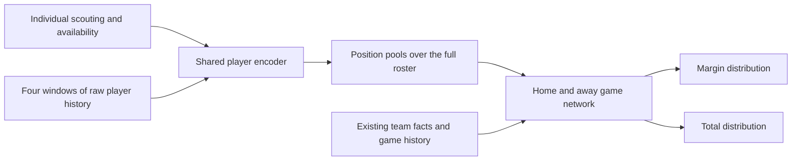

# Individual player identities, scouting, and history

The new pregame model encodes every available roster member directly inside the neural network. Person resolution is season/program scoped; raw provider IDs are retained for audit, not treated as globally reliable person identities. The original production checkpoints remain reproducible. Historical results and deployment status are recorded below.

## Research and design

[Deep Sets (Zaheer et al., 2017)](https://arxiv.org/abs/1703.06114) establishes the shared element encoder plus symmetric pooling approach for unordered sets. This fits a football roster: changing the order of players must not change the forecast. We implemented a compact shared player encoder and compare mean/max pooling with learned attention pooling. Both include position-group counts so adding depth is distinguishable from permuting a roster.

[Set Transformer (Lee et al., 2019)](https://proceedings.mlr.press/v97/lee19d.html) motivates attention for learning which set elements matter and their interactions. Our attention challenger uses a small learned pooling function, **not the full Set Transformer architecture**. With roughly 20,000 historical games, the initial comparison deliberately limits capacity: the mean/max player encoder adds 5,976 parameters, plus the connections into the existing game tower. This is an empirical architecture choice, not a claim that one architecture is universally best.

The [CFBD recruiting API](https://github.com/CFBD/cfbd-python/blob/main/docs/RecruitingApi.md) provides individual HighSchool, JUCO, and PrepSchool records. Its [recruit schema](https://github.com/CFBD/cfbd-python/blob/main/docs/Recruit.md) includes recruiting and athlete IDs, recruiting class, school, position, rating, stars, ranking, and body measurements. Those IDs need validation against actual college identities; neither matching IDs nor matching names alone is sufficient in this dataset.

## Identity corrections

The versioned rules and evidence are in `data/player_identity_overrides.json`. Seventeen reviewed cases cover identity collisions, duplicate aliases, incorrect recruiting assignments, and legitimate gaps in roster coverage. Examples:

| Case | Correction and primary evidence |
|---|---|
| Preston Carey | Georgia's [2026 freshman](https://georgiadogs.com/sports/football/roster/preston-carey/10710) cannot inherit Coastal Carolina's 2016–18 player history. |
| Marquez / Macho Stevenson | Merge duplicate representations of the [Tulane transfer from Texas Tech](https://tulanegreenwave.com/sports/football/roster/macho-stevenson/17139); exclude the older Houston receiver's history and scouting. |
| Chris Tooley III | FAU [explicitly identifies the 2016–19 player as his cousin](https://fausports.com/sports/football/roster/chris-tooley-iii/18338). Split the current player's career from 2023. |
| Tyler Brown | Clemson's [2023 freshman](https://clemsontigers.com/sports/football/roster/season/2023/tyler-brown-wr/) must not inherit the 2017–20 roster entry. |
| Kaleb Jackson | Preserve the [LSU running back's college history](https://goheels.com/sports/football/roster/kaleb-jackson/28199), reject Xavier Jackson's recruiting record, and attach Kaleb's verified 2023 LSU recruiting record. Do not merge him with CJ Jackson merely because that recruiting record has CJ's provider ID. |
| Tre Smith | Preserve the [San José State → Arizona career](https://arizonawildcats.com/sports/football/roster/tre-smith/19319); his linked Genesis Smith recruiting record belongs to someone else. |
| Ty Tanner | The [official Boise State prospectus](https://broncosports.com/documents/download/2026/3/23/2026_Boise_State_Football_Spring_Prospectus.pdf) documents a 2023–25 mission and 2022 statistics. Preserve his history across the gap. |
| Josh Hough / Jacob Jeudy / Darius Hampton | Official current-team biographies document time at junior colleges and Division II programs. Missing annual roster entries do not mean they are different people. |

Automatic rules also reject mismatched names, incompatible recruiting class dates, ambiguous simultaneous program memberships, and unreviewed long gaps/careers. A unique, explicitly linked recruiting record with a consistent timeline can bridge missing roster seasons. Unsupported matches remain unknown. Every accepted/rejected link is retained.

All **flagged current FBS cases** were reviewed and resolved. That is not a certification that every upstream entry across all historical divisions is error-free. Other-division unresolved cases stay quarantined, and the checks rerun on refresh.

## What enters the network

Each player has 30 static inputs: separate high-school/JUCO/prep rating, stars, rank, years since the recruiting class, scouting/body-measurement availability, dated recruiting height/weight, identity uncertainty, observed prior-program membership, and observed college seasons.

There are four history windows: previous season, two seasons ago, earlier career, and current season strictly before the target kickoff. Each contains 27 raw counting statistics plus 27 observation counts, box-score appearances, and FBS box-score appearances. These cover passing, rushing, receiving, defense, turnovers, kicking, punting, and returns. Sums and observation counts remain separate; an unobserved field is not silently interpreted as zero production. Fixed log transforms control numeric scale; there is no separately fitted player-strength model.

The network encodes each history window, combines it with scouting and a dated recruiting-position embedding, then pools every player into roster context. It combines that learned context with the existing 324-feature combination, team/conf embeddings, and team-game histories. It retains exact team-order consistency at inference. No player-ID lookup embedding, market input, inferred starter label, or arbitrary top-N roster cutoff is used.



The old career, participation, returning-production, portal, and preseason-passer scalar summaries are rebuilt from the corrected identities too. Otherwise contaminated old summaries could still reach the network through its scalar inputs. Historical roster class and body-size scalar fields are masked because the upstream feed can overwrite them with later values; dated recruiting measurements supply the new player's body-size inputs.

## Coverage and timing

The final v3 build contains 372,782 roster-person-season rows, 959,005 usable deduplicated player-game records, and about 4.25 million player references across 28,483 target games. The largest roster has 197 players; none are truncated.

At the September 6, 2026 evening cutoff, all 138 FBS teams have roster inputs: 15,772 players, 9,286 with usable scouting, 6,981 with observed prior college box history, and 3,354 observed previously at another program. All 1,402 future games receive explicit player inputs. No future FBS team-side is missing its roster. Nine other-division future team-sides have no public roster in the collected feed and are explicitly marked missing.

Identical duplicate box observations collapse. Conflicting values remain missing. Player aliases cannot double-count the same game. All games at a kickoff timestamp are emitted before results at that timestamp are consumed. Unplayed games never advance history. Transfers retain earlier program production under the corrected person identity.

Every collected 2026 FBS box observation with a positive player ID resolves to a usable person identity. Negative provider IDs representing team/aggregate entries are excluded from individual histories. Unresolved lower-division player observations remain in the quarantine audit.

Publication-time limitations remain: annual roster membership and recruiting revisions do not come with archived availability timestamps. Later identity evidence can correct who an old observation belongs to, but outcome/statistic windows remain strictly prior to the target. Public coverage is not complete for snaps, starters, injuries, offensive-line blocking, junior colleges, or all lower-division game statistics. A missing box row never proves a player did not play.

## Evaluation protocol

The final frozen experiment is `models/experiments/players_20260906_v3/plan.json`. It compares corrected scalar-only control, mean/max player pooling, and attention player pooling on 2020–22 rolling forecasts with two seeds. The player pooling choice is frozen by development margin MAE. The selected player model and corrected control then receive three-seed rolling forecasts for 2023–25, compared on identical games, with early-season slices, winner probability metrics, totals, and paired uncertainty. Those years have been examined previously and are historical benchmarks, not untouched tests. No 2026 outcomes fit or select model weights.

Headline selection and comparison metrics cover FBS-versus-FBS matchups, matching the earlier experiments. The prediction files also retain other FBS-involved matchups, and the future scorer covers the entire current target set, including lower-division games.

Every fold selects epochs on the preceding year, then refits all earlier seasons for that fixed epoch count. Normalization is fitted on training rows only. Small gains are reported and retained; there is no arbitrary minimum-point cutoff for keeping a candidate. Preliminary v1/v2 builds were superseded during identity review, with their completed diagnostic artifacts retained separately.

A separate `blend_plan.json`, frozen before the later-year player assessment, tests player/control probability mixtures at player weights 0%, 25%, 50%, 75%, and 100%. It selects the weight using only 2020–22 margin MAE and applies that same weight to both distributions in 2023–25. This checks whether complementary errors provide a cumulative gain, without tuning mixture weights on the assessment years.

The development choice is 50% player / 50% corrected control. Its development margin MAE is 13.0825 versus 13.1117 for control and 13.1137 for the standalone mean/max player model. A frozen `seed_control_plan.json` adds a four-member development control and six-member assessment control to match the mixture's total number of members. This helps separate new player information from ordinary variance reduction through additional ensemble members. Additional control seeds train on CPU; the original rolling runs train on MPS. Neither the player architecture nor mixture weight is retuned using these later controls.

With equal development member counts, scalar control MAE is 13.1065 and the 2+2 blend is 13.0825: a 0.0241-point improvement. This remains a development-selected result, with a descriptive paired interval crossing zero; later-year comparisons determine how well it carries forward.

## Running and refreshing

Commands run from the repository root with `PYTHONPATH=src`. A base input directory must contain the complete current game scalars, history, vocabulary, schedule, market benchmark, and recent-form files from the same refresh.

For routine use after the normal local raw-data and `features_raw.py` refresh has completed, run **`python3 src/cfbpred/refresh_player_candidate.py`**. It creates new dated snapshots, rebuilds recent form and corrected individual/scalar inputs, scores both saved bundles at one cutoff, applies the frozen blend, and audits both components. `models/player_forecast_refreshes/latest.json` points to the latest successfully audited artifact. No retraining or market input is needed, and the existing published model is not replaced by this command. An unresolved current FBS player identity or missing future FBS roster makes the audit fail instead of silently advancing that pointer.

The commands below describe the original build. Completed player/input snapshots are protected from accidental overwrites. For a new weekly data refresh, use new dated `--players` and `--output` directories in the preparation step, then pass those directories through `--players` and `--inputs` when scoring and auditing the saved model. Keep the checkpoint bundle directory unchanged when scoring a refresh; its fitted scalers and vocabulary remain authoritative. `--reuse-players` is only appropriate when rebuilding scalar inputs against the exact same player snapshot and schedule.

```sh
python3 src/cfbpred/prepare_player_data.py --base models/experiments/margin_form_20260906/inputs --output models/experiments/players_20260906_v3/inputs
python3 src/cfbpred/player_experiment.py
python3 src/cfbpred/player_blend_experiment.py evaluate
python3 src/cfbpred/player_forecast.py train
python3 src/cfbpred/player_forecast.py score
python3 src/cfbpred/audit_player_forecast.py
```

To produce the development-selected ensemble as well, train the corrected control using `player_forecast.py train --pooling corrected_control --directory models/experiments/players_20260906_v3/current_control_2026`, then run `python3 src/cfbpred/blend_player_forecasts.py`. It scores the control at the exact same cutoff and target set as the saved player forecasts, verifies their schedules agree, and applies the frozen development weight to their full probability distributions. Both component forecasts and the blend are retained. CPU training (`--device cpu --threads 2`) is supported for concurrent current-season fitting while the historical backtest uses the GPU.

The forecasting loader verifies checkpoint hashes, player/scalar schema and data provenance, reuses checkpoint scalers, and maps unseen team identities to unknown. It fails if any target lacks a roster reference, rather than quietly dropping that game. The forecast artifact includes full margin/total PMFs and a snapshot timestamp. Player checkpoints are explicitly **pregame-only**; inference refuses to use them as an untrained live model. Started production forecasts are not rewritten by this candidate forecast command.

The final forecast audit checks the complete future target set, normalized distributions, agreement between distributions and displayed predictions, every checkpoint's training seasons, and strictly prior player-history timestamps. It also measures the effect of removing scouting, prior college history, and current-season player history from a saved model. That last diagnostic confirms the inputs reach the predictions; the historical comparison measures whether they improve accuracy. A historical checkpoint reloaded on CPU reproduces its saved GPU forecasts within 0.00000012 probability per bin.

## Completed implementation checks

All 97 repository tests pass, and the new modules compile. Tests cover identity collisions and alias merges, valid transfers and roster gaps, wrong recruiting links, duplicate/conflicting boxes, same-kickoff leakage, rosters of 200 players without truncation, permutation/padding invariance, gradients through scouting, team-order consistency, saved normalization/vocabulary, and rejection of incomplete inference or current-season-trained checkpoints.

Both current-season bundles are trained: three player members and three corrected-control members, each with 26,873 eligible pre-2026 training games and a latest training season of 2025. The standalone player model and 50/50 blend each produced all 1,402 future forecasts. Both component audits passed, including zero missing future FBS rosters and zero unresolved positive-ID current FBS box rows.

The full refresh command rebuilt inputs from the active local feature store into a separate dated directory and passed both audits. Its win probabilities, expected margins, and expected totals match the experiment's 1,402 blended forecasts exactly. See `refresh_parity_report.json` and `models/player_forecast_refreshes/latest.json` for the verified outputs.

Removing inputs from one trained member across 128 future games changes predicted margin by an average absolute 0.0806 points for scouting, 0.0138 for prior college history, and 0.0044 for current-season player history. These diagnostics show a modest direct influence in that sample; they do not measure accuracy benefit or prove individual player value.

## Results and status

The completed rolling assessment covers **2,398 FBS-versus-FBS games in 2023–25**. All metrics below are lower-is-better. Mean/max pooling and the 50/50 mixture were selected on 2020–22 and kept fixed.

| Model | Margin MAE | Total MAE | Winner log loss |
|---|---:|---:|---:|
| Original baseline, 3 members | 12.6938 | 13.0426 | 0.55450 |
| Previously retained combination, 3 members | 12.6679 | 12.9402 | 0.55258 |
| Corrected scalar control, 3 members | 12.7136 | 13.0111 | 0.55315 |
| Individual player model, 3 members | 12.7182 | 12.9960 | 0.55371 |
| Corrected scalar control, 6 members | 12.6791 | 12.9714 | 0.55087 |
| Selected blend, 3 player + 3 control members | 12.6966 | 12.9937 | 0.55243 |

The standalone player encoder changes margin MAE by +0.0046 points versus the corrected three-member control: effectively level. The blend improves on that three-member control by 0.0170 points, with a paired 95% interval for the change of [-0.0478, +0.0131].

Against the **equal-size six-member control**, the blend is 0.0176 points worse, with interval [-0.0167, +0.0513]. Neither comparison establishes a reliable incremental accuracy gain from the individual encoder. The six-member control also has lower total error and winner log loss than the blend.

| Assessment season | Control, 6 members | Blend, 3 + 3 members |
|---|---:|---:|
| 2023 | 12.5132 | 12.4964 |
| 2024 | 13.0315 | 13.1213 |
| 2025 | 12.4935 | 12.4735 |

For weeks 1–3 (438 games), margin MAE is 13.3280 for the equal-size control and 13.3126 for the blend. That small early-season gain is retained and reported; it does not overturn the mixed overall comparison.

On the **2,396 market-matched games**, the blended model has margin MAE **12.7043**, versus **12.0296** for the archived closing line. The remaining gap is 0.6747 points. This implementation has not established parity with Vegas.

**Adoption status:** the identity corrections, individual network, all experiment checkpoints, both current-season bundles, and all future forecasts are retained. The new pipeline is a runnable pregame candidate. The existing production/live ensemble remains active; these candidate commands do not publish or replace it. The corrected player inputs are used by the new pipeline, and must not be assumed to be present in the older checkpoints. Live conditioning for the new player model has not been retrained or validated.

The implementation is complete and its full refresh is tested. The prediction-quality result is uncertain, not a demonstrated upgrade. Retaining a small measured gain is appropriate; attributing ordinary ensemble variance reduction to player information would overstate this experiment.

Artifacts: [main assessment](../models/experiments/players_20260906_v3/report.json), [blend assessment](../models/experiments/players_20260906_v3/blend_report.json), [equal-size comparison](../models/experiments/players_20260906_v3/seed_control_report.json), [forecast audit](../models/experiments/players_20260906_v3/forecast_audit.json), and [latest fully audited future forecasts](../models/player_forecast_refreshes/latest.json).
